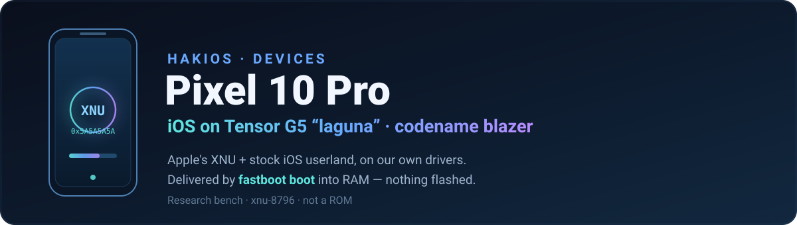
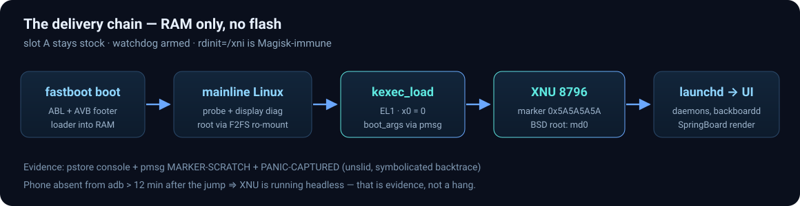

# Pixel 10 Pro · `blazer`
### HakiOS on Google Tensor G5 (“laguna”) — Apple's XNU, our drivers, your phone

*An HakiOS device port for the Google Pixel 10 Pro — booting Apple's XNU and the
stock iOS user space on top of our own platform layer and drivers. The loader
goes into RAM through **`fastboot boot`**, the system lives in RAM for a
session, and a reboot brings the phone back to its own Android. Nothing is
flashed, userdata is never erased, and slot A stays stock. A research bench,
not a ROM.*

---

## Why this directory exists

The kernel, loader and user space are shared with the rest of HakiOS. Everything
that is **specific to this phone** lives here: its device tree, its drivers, its
tools and its notes. A port to another phone is a new directory like this one.

**Laguna is not a Qualcomm SoC.** The `soc_*` register-argument machinery and
the MPSS/IPA/Hexagon modem stack used by the Qualcomm ports do not apply. This
port brings its own platform layer and drivers in the same boot-argument style,
and reuses the SoC-independent pieces: the Mini* stand-ins, the AMFI/dyld-policy
answer, the Mesa/GLI renderer path, the userland image build, and the
`fastboot boot` RAM-only delivery.

---

## Status at a glance

| Area | State |
| --- | --- |
| XNU entry on the phone (kexec ladder) | ✅ Proven ×4 on real hardware (entry marker `0x5A5A5A5A`) |
| Direct tegu-style shim → XNU | ✅ Reaches the kernel; watchdog + fault-screen console; EL2→EL1 drop at the final jump landed (v3.7 shim, register-for-register with the tegu sequence) |
| **Evidence channels (death instrumentation)** | ✅ **Live** — TSHIMST2 shim stamps (pmsg+0x30000, nonce-matched provenance), XNU-MSGBUF v2 mirror + breadcrumbs, abl.log, pstore; proven end-to-end on real dumps. Kit now includes the evidence lab (attempt runner + ledger + decoders) and the ABL teardown docs — [`porting-kit/`](porting-kit/) |
| **On-device delivery chain** | ✅ Proven on hardware — probe → 14 kexec segments → `kexec_load result=0` → XNU handoff magic `0x30484e58` at pmsg+`0x120` |
| **Current frontier** | 🚧 USB-console shim cold path: the LPCM mailbox transport works (MBA magic `0x4d4241` confirmed, `mba-ack` completes) but the first clock-gate request came back **REFUSED `0xf8`** — firmware reply codes being decoded ([`porting-kit/evidence-channels/`](porting-kit/evidence-channels/)). Behind it, XNU still dies before `arm_vm_init` — visible only through the post-mortem channels |
| **Stamped evidence loop** | ✅ Proven 4/4 on device — force-fastboot auto-park (persistent devinfo env) + TSHIMST2 trail + immediate ramdump: every shim death decodes to a named stage with the hardware's values attached; EP0 enumerated live once (2026-10-27) |
| **Stock iOS lock screen renders (blazer kernel, QEMU)** | ✅ Composited, updating lock screen; zero panics; SpringBoard up in 26.75 s |
| launchd + root mount in QEMU | ✅ APFS and HFS roots, full daemon set (173 daemons spawned) |
| backboardd → scanout in QEMU | ✅ Display pipeline works end-to-end |
| Software renderer in backboardd | ✅ Mesa softpipe ES3 context created; Apple-logo frame composites |
| Identity records (dslocal) | ✅ Real records generated from the target root and staged root-owned — 150/150 at `0:0`, 940-check gate (`tools/dslocal/`) |
| Delivery images (boot v4 + AVB, `fastboot boot`) | ✅ Host-built and host-validated (kexec control + direct-embedded fallback) |
| Pixel 10 Pro port on the new foundation | 🚧 Platform, display handoff, UFS takeover and panicdump in source — all hardware paths default-off |
| On-device root + dyld cache transport | 🚧 userdata-file → F2FS ro-mount → `md0`; cold UFS/PHY/CPM init stays in the Linux first stage |
| First device render (DPU scanout on hardware) | ⬜ Needs the display-owning Linux first stage emitting the validated handoff (`docs/RENDER.md` §5) |
| Unlock / home-screen swipe, GL flag chain | ⬜ Lock screen is the proven depth; unlock not driven yet; softpipe flags designed, not yet run on the platform image |
| Touch (TCM), Wi-Fi, cellular, camera, charging, BT | ⬜ Unstarted on this SoC |
| Secure Enclave / activation / Apple account | ⛔ Out of scope by design |

<strong>QEMU evidence (not the physical phone)</strong>

<em>The Apple-logo frame composited by our Mesa softpipe renderer inside
backboardd, captured in QEMU. Included as proof the render path works — it is a
QEMU capture, not a claim of an on-device lock screen.</em>

The render milestone behind the status table: the blazer-branch kernel (built
from this branch's source model) boots the verified userland image on the
upstream QEMU harness to the **stock iOS lock screen over the color
wallpaper** — full UI content from ~255 s, then stable frames with the
lock-screen clock's minute ticks; 36 frame captures; zero `panic(` lines;
pixel-match 2.9–3.1/255 against an independent control boot (residual = the
clock digits). One honest boundary: the QEMU loader's synthesized ADT carries
the iPhone identity, so `BlazerPlatformExpert` (matched by
`google,lga-blazer`) cannot engage there — the milestone proves the kernel's
userland/display stack end-to-end, while the SoC-specific drivers engage on
the first-stage ADT contract (`docs/BOOT-CONTRACT.md` §2).

---

## The phone

| Thing | Value |
| --- | --- |
| Codename | `blazer` |
| SoC | Google Tensor G5, `laguna` |
| DT compatible | `google,lga-blazer` |
| Panel | 1280 × 2856 — DPU `sswrp_dpu@ec00000`, `dc9x00@200000` |
| Watchdogs | `watchdog_cl0@200c4000`, `watchdog_cl1@200c5000` (`google,wdt`) |
| CPM mailbox | TX `0x05260000`, RX `0x05261000` — goog-mba v2, drives DPU power |
| ramoops | `ramoops@95200000`, 4 MiB, survives resets → `/sys/fs/pstore/console-ramoops-0` |
| pmsg marker zone | PA `0x95400000` (+0x100 entry marker, +0x1000 scratch, +0x30000 panic mirror) |
| kexec window | `0x80000000` + 256 MiB (proven on device) |

The live device tree is in [`fdt/laguna.dtb`](fdt/laguna.dtb). Refresh it with
[`tools/pull-fdt.sh`](tools/pull-fdt.sh) if the boot chain changes.

---

## Delivery

Two delivery paths are being ported, and **neither requires flashing**:

1. **The kexec ladder** (proven on device): ABL → mainline Linux with
   `CONFIG_KEXEC=y` → a probe that raw-`kexec_load`s XNU at EL1. The entry stub
   is patched with a base-independent marker/branch so a raw kexec delivering
   `x0 = 0` still receives `boot_args` through the pmsg zone.
2. **The direct shim** (tegu-style): ABL → a small shim that hands off to XNU
   in one hop, with early watchdog quiesce and a framebuffer findings console.

Read [`docs/SAFETY.md`](docs/SAFETY.md) before running anything on a real phone.
Both paths are already built and host-validated as boot-v4 + AVB images (see
[`docs/BUILD.md`](docs/BUILD.md)); the only unproven step is the phone itself.

### Magisk / `init_boot` ramdisk race (rooted phones)

On a rooted Pixel the ABL concatenates the vendor ramdisk fragment with
`init_boot`'s generic ramdisk (Magisk-patched). Magisk's `/init` unpacks last
and wins, so a normal `rdinit=/init` runs **magiskinit**, not our probe. The
workaround here is **`rdinit=/xni`**: the probe's init entry is renamed to a
path the Magisk fragment does not contain, and the kernel's builtin cmdline is
appended last so `rdinit=/xni` wins. Do not “fix” this by touching `init_boot`.

---

## How to help

| Task | What it needs |
| --- | --- |
| **Decode the LPCM reply codes (current frontier)** | The shim's LPCM mailbox requests complete but the first USB clock-gate came back status `0xf8` (and the response word carries `0x8400000fffffff8`). Map the firmware reply/status bytes to meanings — ABL's own callers are the reference ([`porting-kit/evidence-channels/ABL-MBA-PROTOCOL.md`](porting-kit/evidence-channels/ABL-MBA-PROTOCOL.md)); every refusal is stamped with raw values in the park dumps. |
| **Cold UFS/DPU production (the big one)** | A display-owning **Linux first stage** that brings up Google's UFS/PHY/CPM cold, programs a dedicated linear scanout, preserves it across kexec and emits the validated 128-byte handoff. That single piece unlocks the first on-device render. The exact CPM frames, gates and record contract are in [`docs/RENDER.md`](docs/RENDER.md) §2–§6; the CDPHY power-off discovery and the revive ladder are in [`porting-kit/evidence-channels/DISPLAY-PRODUCER.md`](porting-kit/evidence-channels/DISPLAY-PRODUCER.md). Hard lesson: DC9x00 readback on real silicon is an **async SError → DER Event 20 crash reset** (`0xc00e`), even though it is harmless in QEMU — keep every probe/readback off. |
| **Touch (TCM)** | The host-tested driver exists (198/198). Needs on-device AOC pad-slot layout, TBN bus-parked check, CPM hard reset/rails, TCM generation detect, SSI clock liveness. |
| **UFS / root transport** | A normal userdata file (adb push) that the ladder's Linux stage ro-mounts (F2FS) and kexec-segments as `md0`. Cache files must be **uid 0**; there must be no `/usr/lib/system/libdispatch.dylib` on disk (the built image already satisfies both — see `docs/BUILD.md`). |
| **GL flag chain** | A `GL=1 REST=1` userland build exercised with the softpipe boot-args on the platform image (`docs/RENDER.md` §8–§9). Never `gpu=1` — that is the Qualcomm Adreno driver. |
| **`var_store` backend** | A safe Tensor storage/write path with partition-independent bounds and read-back verification, before `var_store=1 ufs_write=1` are ever set. |
| **SpringBoard depth** | The lock screen renders in QEMU; the next walls are first-unlock and scene-building, not the display pipeline. See [`docs/PORTING.md`](docs/PORTING.md). |
| **Cellular, Wi-Fi, camera, charging, BT** | Unstarted on this SoC — and unlike the Qualcomm ports, there is no MPSS/IPA/Hexagon stack to port; cellular would be a new project of its own. |

---

## Layout

| Path | What |
| --- | --- |
| [`assets/`](assets/) | banner, boot-chain diagram, QEMU evidence |
| [`fdt/`](fdt/) | the phone's device tree |
| [`files/`](files/) | laguna driver sources (mailbox first) |
| [`tools/`](tools/) | device-tree and log tools, plus [`tools/dslocal/`](tools/dslocal/README.md) — the identity-record staging kit any port can reuse |
| [`porting-kit/`](porting-kit/) | the folded death-instrumentation kit — msgbuf-mirror patch + format contract, standalone ramdump reader, USB EP0 console runbooks + builder (v3.7 flow), the evidence lab (attempt runner, ledger, decoders), the ABL/MBA/CDPHY teardown docs, and the measured pmsg evidence-channel map |
| [`docs/PORTING.md`](docs/PORTING.md) | the full porting checklist and current wall map |
| [`docs/BUILD.md`](docs/BUILD.md) | clean kernel build, marker and host-validation recipe |
| [`docs/BOOT-CONTRACT.md`](docs/BOOT-CONTRACT.md) | kexec/direct entry, ADT, boot-args and RAMDisk→md0 |
| [`docs/RENDER.md`](docs/RENDER.md) | display/render bring-up: CPM → DPU → scanout handoff, softpipe + EAGL/GLI, boot-arg profiles |
| [`soc.args`](soc.args) | FDT-generated Tensor handoff addresses (no Qualcomm `soc_*`) |
| [`docs/SAFETY.md`](docs/SAFETY.md) | the on-device safety rails — read first |

Nothing here is an iOS binary, image, cache, font, picture or the phone's
firmware. Those come from your own IPSW and your own phone, as in the rest of
the project; see the top-level `LEGAL.md`.

---

## Contributing and contact

**Forks and pull requests are very welcome.** This is an active bring-up, and
help is especially wanted on the display-owning Linux first stage (cold UFS +
DPU scanout production — the piece that unlocks the first on-device render),
TCM touch, the GL flag chain and the remaining unlock/scene-building walls.

Questions, dumps from your own Pixel 10 Pro, or offers to help: **Discord
`@andersmadsen`**. If you have a laguna/Tensor device and a boot log, that is
often the fastest way to unblock a driver.

Two house rules, same as the rest of the project: no Apple binaries, images,
caches or phone firmware in the repo (see the top-level `LEGAL.md`), and read
[`docs/SAFETY.md`](docs/SAFETY.md) before touching a real phone.
